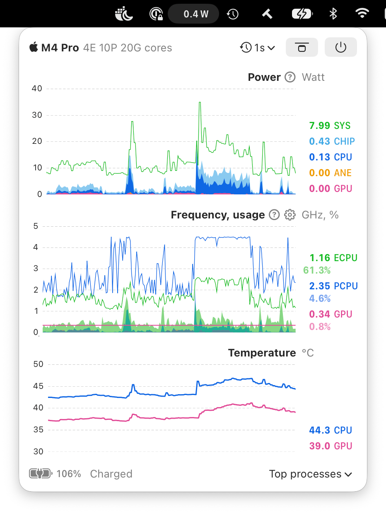

# StillCore

StillCore is built for continuous Apple Silicon monitoring with low overhead. It stays in the macOS menu bar, quietly tracks what the Mac is doing, and is ready when something suddenly feels off: the laptop gets warm, battery drain jumps, or a background task briefly spikes power usage.

It’s designed for everyday monitoring rather than deep profiling. It is built on top of [macmon](https://github.com/vladkens/macmon), which provides the core Apple Silicon metrics.


## Main features:

- System and chip power with stacked CPU, GPU and Neural Engine readings.
- CPU and GPU frequency and usage on the combined chart.
- Temperature charts.
- Top processes by CPU and GPU usage, memory or CPU power, with controls to quit them or limit their power use.
- Adjustable update interval from 100 ms to 10 seconds.
- Customizable menu bar metrics, a battery icon or percentage, and an optional always-open window.
- Battery drain tracking with active and sleep time since unplugging.
- Detailed battery charge statistics.
- Switch between Automatic and Power Save modes for the current power source.

<p align="center">

</p>


## Download

Prebuilt downloads are available on the GitHub releases page:
https://github.com/homm/StillCore/releases

Requires an Apple Silicon Mac with macOS 14 or newer.


## Why I Built It

I often work on a laptop and want to understand what is happening with energy usage. I used MX Power Gadget for this, but later found that it reports misleadingly low power for itself while consuming a lot of CPU power in practice[^mx-power-gadget]. That led me through several monitoring experiments, and eventually to the decision that I could build something better for my own workflow.

During development, I paid attention to StillCore's own footprint. The table below shows power usage while running different monitoring apps as `CHIP`: `CPU` + `GPU` in watts. For example, the idle baseline without any background apps is `0.17`: `0.01` + `0.00`.

| App                                         | Mode                   | 1 sec update interval                              | 100ms update interval                              |
| ------------------------------------------- | ---------------------- | -------------------------------------------------- | -------------------------------------------------- |
|                                             |                        | `CHIP`: `CPU` + `GPU`                              | `CHIP`: `CPU` + `GPU`                              |
| **StillCore**                               | In tray<br>Interactive | `0.17`: `0.01` + `0.00`<br>`0.21`: `0.02` + `0.00` | `0.19`: `0.02` + `0.00`<br>`0.47`: `0.06` + `0.02` |
| **Activity Monitor** macOS 27.2             | In tray<br>Interactive | `0.3`: `0.1` + `0.00`<br>`0.53`: `0.21` + `0.00`   | -<br>-                                             |
| **MX Power Gadget** 1.6.4[^mx-power-gadget] | In tray<br>Interactive | `1.93`: `1.17` + `0.00`<br>`1.93`: `1.18` + `0.01` | -<br>-                                             |

[^mx-power-gadget]: MX Power Gadget uses `powermetrics` for its measurements, but according to this [Habr article in Russian](https://habr.com/ru/articles/858736/), it starts a new `powermetrics` process for each sample. Because `powermetrics` has a relatively expensive startup phase, the utility can consume a few watts in practice even when its own charts show near-zero power.


## Development

### Build From Source

Building from source requires Xcode with Swift 6 support and network access for Swift Package dependencies.

Create a local DMG from source:

```sh
make dmg
```

This creates the Release `StillCore.dmg`.

Remove build artifacts:

```sh
make clean
```


### Local Development

Development builds use `CONFIGURATION=Debug` by default.

Install repository-managed Git hooks once per checkout:

```sh
make install-hooks
```

Make commands:

```sh
# Build and run from the terminal
make run

# Build and run the Release configuration
make run Release

# Build and open the app bundle
make open-app

# Profile a Release build with Instruments Time Profiler
make profile
```


### Local Metrics Core Development

Use `LOCAL=1` to develop or test StillCore with local changes to `macmon`.

Additional requirements:

- Rust toolchain with Cargo
- Local checkouts of `macmon` and `macmon-bindings` next to this repository

Clone the sibling repositories and build the local `macmon` xcframework:

```sh
pushd ..
git clone https://github.com/homm/macmon.git
git clone https://github.com/homm/macmon-bindings.git
make -C macmon xcframework
popd
```

Build and open StillCore against the local metrics core:

```sh
make -C ../macmon xcframework
make open-app LOCAL=1
```

`LOCAL=1` uses `StillCore.local.xcworkspace`, expects `../macmon/dist/CMacmon.xcframework`,
and uses the sibling `../macmon-bindings` checkout.


## License

StillCore is released under the MIT License. The metrics core is built on [macmon](https://github.com/vladkens/macmon), sensor tables adapted from [Stats](https://github.com/exelban/stats). StillCore.app bundles the license notices for [macmon](Licenses/macmon.txt), [Stats](Licenses/Stats.txt), [DGCharts](Licenses/DGCharts.txt), and [Sparkle](Licenses/Sparkle.txt).
