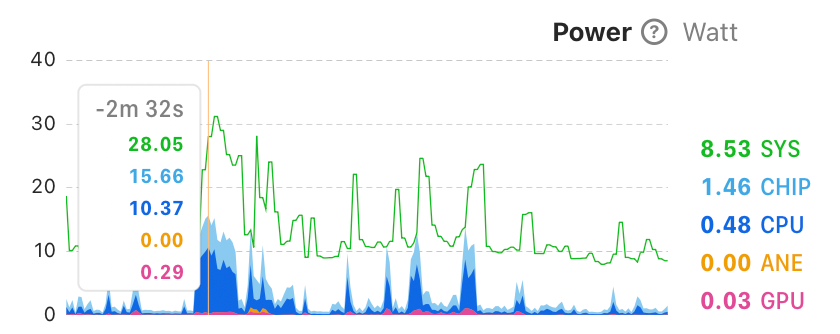
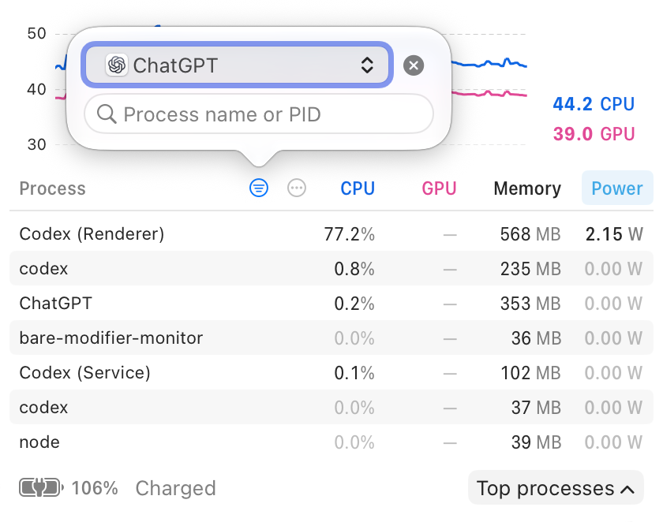
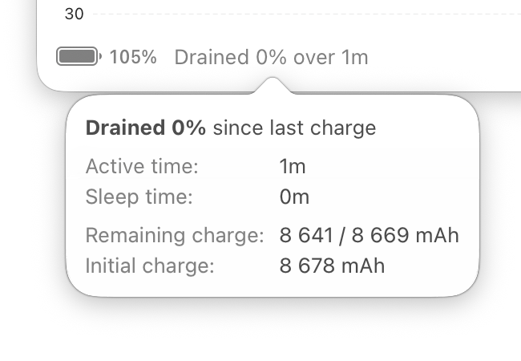
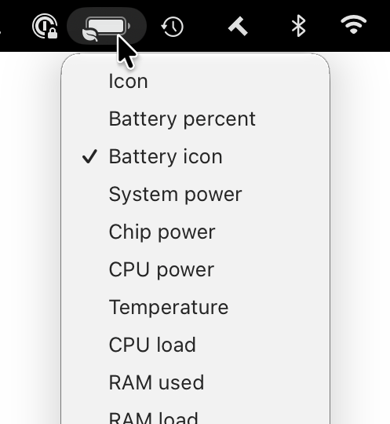

# StillCore

StillCore is built for continuous Apple Silicon monitoring with low overhead. It stays in the macOS menu bar, quietly tracks what the Mac is doing, and is ready when something suddenly feels off: the laptop gets warm, battery drain jumps, or a background task briefly spikes power usage.

It’s designed for everyday monitoring rather than deep profiling. It is built on top of [macmon](https://github.com/vladkens/macmon), which provides the core Apple Silicon metrics.


## Main features:

- System and chip power with stacked CPU, GPU and Neural Engine readings.
- CPU and GPU frequency and usage on the combined chart.
- Temperature charts.
- Top processes by CPU and GPU usage, memory or CPU power, with controls to quit them or limit their power use.
- Adjustable update interval from 100 ms to 10 seconds.
- Customizable menu bar metrics, a battery icon or percentage, and an optional always-open window.
- Battery drain tracking with active and sleep time since unplugging.
- Detailed battery charge statistics.
- Switch between Automatic and Power Save modes for the current power source.

<p align="center">

</p>


## Download

Prebuilt downloads are available on the GitHub releases page:
https://github.com/homm/StillCore/releases

Requires an Apple Silicon Mac with macOS 14 or newer.


## Features



### Power and Activity

Compare total system power with chip power and see how much the CPU, GPU, and Neural Engine contribute. Use the chart marker to see what was happening when power spiked.

<br clear="all">




### Top Processes

Sort processes by CPU usage, GPU usage, memory, or CPU power to find what’s using the most resources. Filter by application, process name, or PID. Quit a process or apply a background policy from the list.

<br clear="all">




### Battery Charge and Drain

See how much charge remains and how much you’ve used since unplugging. The battery popover also shows how long your Mac was awake and asleep during that session.

macOS can report 100% below full capacity. StillCore can show charge above that threshold, so you can see it drop after unplugging while macOS still reads 100%.

<br clear="all">




### Menu Bar and Floating Window

Choose which metrics appear in the menu bar so you can check them at a glance. Detach the main window to keep the charts visible while you work.

<br clear="all">


## Why I Built It

I often work on a laptop and want to understand what is happening with energy usage. I used MX Power Gadget for this, but later found that it reports misleadingly low power for itself while consuming a lot of CPU power in practice[^mx-power-gadget]. That led me through several monitoring experiments, and eventually to the decision that I could build something better for my own workflow.

I wanted StillCore to stay in the menu bar all day without adding much overhead. In my tests, with StillCore running in the menu bar and updating once a second, chip power matched the idle baseline of 0.17 W. With the window open, it rose to 0.21 W. For comparison, chip power was lower with StillCore updating every 100 ms (0.47 W) than with Activity Monitor updating once a second (0.53 W), with their windows open.

[^mx-power-gadget]: MX Power Gadget uses `powermetrics` for its measurements, but according to this [Habr article in Russian](https://habr.com/ru/articles/858736/), it starts a new `powermetrics` process for each sample. Because `powermetrics` has a relatively expensive startup phase, the utility can consume a few watts in practice even when its own charts show near-zero power.

Here are some cases where StillCore helped me track down unexpected power use.

#### Codex GPU usage

StillCore’s GPU charts showed spikes up to 1.5 W on my M4 Pro while Codex was thinking. After some experimenting, I traced the extra GPU load to a tiny spinner in the sidebar. I [filed an issue](https://github.com/openai/codex/issues/16857) and started hiding the sidebar while Codex worked. The bug has since been fixed.

#### Mission Control on macOS 27

I traced CPU spikes during trackpad gestures to `MenuBarAgent`. It used one CPU core while I moved my fingers to open Mission Control or App Exposé, then dropped as soon as I held them still. I used StillCore to apply a background task policy to the process and limit its impact.

#### Playing Civilization VI over the Atlantic

A transatlantic flight lasts about ten hours. By measuring how much power Civilization VI draws with StillCore, I can tune the game settings so I can play for the whole flight on a single charge. 😆


## Development

### Build From Source

Building from source requires Xcode with Swift 6 support and network access for Swift Package dependencies.

Create a local DMG from source:

```sh
make dmg
```

This creates the Release `StillCore.dmg`.

Remove build artifacts:

```sh
make clean
```


### Local Development

Development builds use `CONFIGURATION=Debug` by default.

Install repository-managed Git hooks once per checkout:

```sh
make install-hooks
```

Make commands:

```sh
# Build and run from the terminal
make run

# Build and run the Release configuration
make run Release

# Build and open the app bundle
make open-app

# Profile a Release build with Instruments Time Profiler
make profile
```


### Local Metrics Core Development

Use `LOCAL=1` to develop or test StillCore with local changes to `macmon`.

Additional requirements:

- Rust toolchain with Cargo
- Local checkouts of `macmon` and `macmon-bindings` next to this repository

Clone the sibling repositories and build the local `macmon` xcframework:

```sh
pushd ..
git clone https://github.com/homm/macmon.git
git clone https://github.com/homm/macmon-bindings.git
make -C macmon xcframework
popd
```

Build and open StillCore against the local metrics core:

```sh
make -C ../macmon xcframework
make open-app LOCAL=1
```

`LOCAL=1` uses `StillCore.local.xcworkspace`, expects `../macmon/dist/CMacmon.xcframework`,
and uses the sibling `../macmon-bindings` checkout.


## License

StillCore is released under the MIT License. The metrics core is built on [macmon](https://github.com/vladkens/macmon), sensor tables adapted from [Stats](https://github.com/exelban/stats). StillCore.app bundles the license notices for [macmon](Licenses/macmon.txt), [Stats](Licenses/Stats.txt), [DGCharts](Licenses/DGCharts.txt), and [Sparkle](Licenses/Sparkle.txt).
